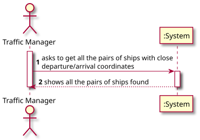
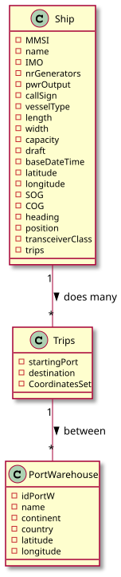
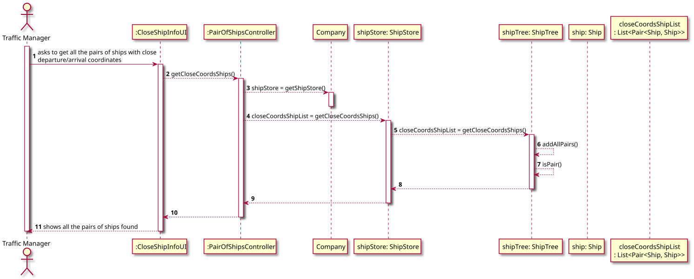
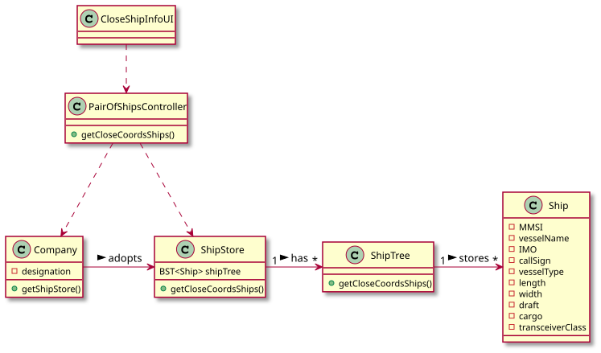

# US 107 - Get Close Coordinates Ships

## 1. Requirements Engineering

### 1.1. User Story Description

As a **traffic manager**, I wish to get all the pairs of ships with routes with close departure/arrival coordinates (no
more than 5 Kms away) and with different Travelled Distance.

### 1.2. Customer Specifications and Clarifications

**From the Specifications Document:**

>	n/a

**From the client clarifications:**

>	**Question:** Regarding both US106 and US107 should we assume that these functionalities will be used by the Traffic Manager or is it for another role in the company? This detail is not present, unlike in the other User Stories.
>
>	**Answer:** Yes, you can assume a Traffic Manager will be performing those tasks.

---

>	**Question:** How do we know the departure and arrival location of a ship on a certain trip? Is it the first & last location received in the AIS messages available in the system? Do we need to verify if the coordinates match the ones of a port from the system database?
>
>	**Answer:** I really don't know. I guess you should talk to the technical team.

### 1.3. Acceptance Criteria

* 	**AC1:** The pairs should appear sorted by the MMSI code of the 1st ship and in descending order of the Travelled Distance difference.
*	**AC2:** Pairs of ships with departure/arrival coordinates that are more than 5 kms away from each other should not be considered.
*	**AC3:** Ships with Travelled Distance less than 10 kms should not be considered.
*   **AC4:** In case of operation success, all the information desired will be presented to the user in the console.

### 1.4. Found out Dependencies

At least two ships and ship locations must be registered in the system, for the information to appear successfully. (US101 dependency)

### 1.5 Input and Output Data

**Input Data:** n/a

**Output Data:**

* List of existing pairs of ships with routes with close departure/arrival coordinates.

### 1.6. System Sequence Diagram (SSD)

### 1.7 Other Relevant Remarks

n/a

## 2. OO Analysis

### 2.1. Relevant Domain Model Excerpt

### 2.2. Other Remarks

n/a

## 3. Design - User Story Realization

### 3.1. Rationale

**The rationale grounds on the SSD interactions and the identified input/output data.**

| Interaction ID 								  | Question: Which class is responsible for... 	  | Answer   			 | Justification (with patterns)  							                         |
|:------------------------------------------------|:--------------------------------------------------|:---------------------|:----------------------------------------------------------------------------------|
| Step 1: asks to get all the pairs of ships with close departure/arrival coordinates|...knowing which user is interacting with the system?                |UserSession    |IE: Knows its own users              |     											  |
|                                                                                    |...coordinating the US?                                              |ShipController |Controller                           |
| Step 2: shows all the pairs of ships found                                         |...knowing all the ships and ship locations registered in the system?|ShipStore      |IE: Knows its own ships              |
| Step 2: shows all the pairs of ships found                                         |...knowing all the ship´s attributes that match the search criteria? |ShipStore      |IE: Knows its own data               |
| Step 2: shows all the pairs of ships found                                         |...showing all the info?                            			 	   |CloseShipInfoUI|IE: Responsible for user interactions|              

### Systematization ##

According to the taken rationale, the conceptual classes promoted to software classes are:

* Company
* Ship

Other software classes (i.e. Pure Fabrication) identified:

* ShipController
* ShipStore
* CloseShipInfoUI

## 3.2. Sequence Diagram (SD)

## 3.3. Class Diagram (CD)

# 4. Tests

**Test 1:** Controller test - Imports sships.csv file, and test the getCloseCoordsList method. An empty list of pairs is expected.

	@Test
    public void getCloseCoordsShips() {
        PairOfShipsController pairOfShipsController = new PairOfShipsController();
        Import imp = new Import(pairOfShipsController.getShipStore());
        String file = "data/data-shipsports/data-shipsports/data-ships&ports/sships.csv";
        try {
            imp.importShipsData(file);
        } catch (IOException e) {
            e.printStackTrace();
        }

        imp.addShips();
        List<Pair<Ship,Ship>> pairOfShipsList = pairOfShipsController.getCloseCoordsShips();

        System.out.println(pairOfShipsController.toString(pairOfShipsList));
        assertNotNull(pairOfShipsList);
        assertEquals(0, pairOfShipsList.size());
    }

# 5. Observations

The domain model classes may have to be modified in future versions of the project, according to the US requirements;