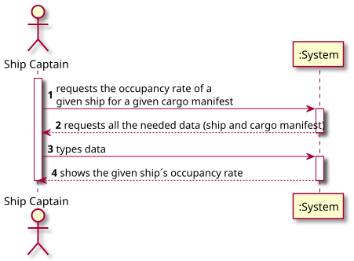
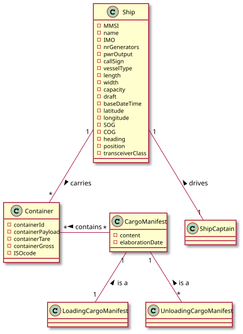
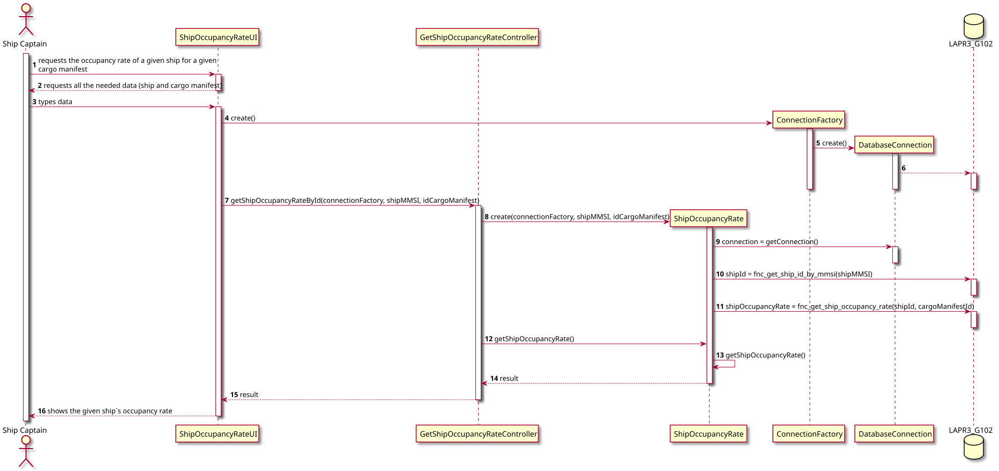
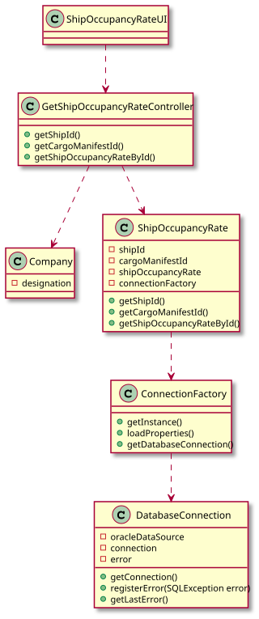

# User Story 208 - Get Ship Occupancy Rate

### User Story Description

As a **Ship Captain**, I want to know the occupancy rate (percentage) of a given ship
for a given cargo manifest. Occupancy rate is the ratio between total number of containers
in the ship coming from a given manifest and the total capacity of the ship, i.e., the
maximum number of containers the ship can load.

### Acceptance Criteria

* 	**AC1:** Ship and cargo manifest are correctly identified.
*	**AC2:** Occupancy rate is properly computed.

### System Sequence Diagram (SSD)

### Relevant Domain Model Excerpt

### Sequence Diagram (SD)

### Class Diagram (CD)

