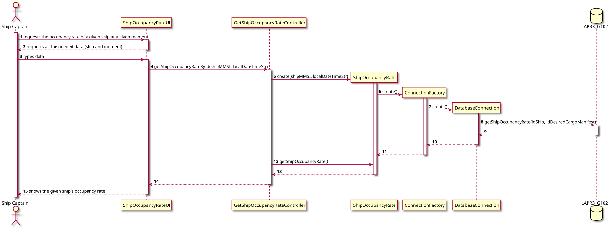
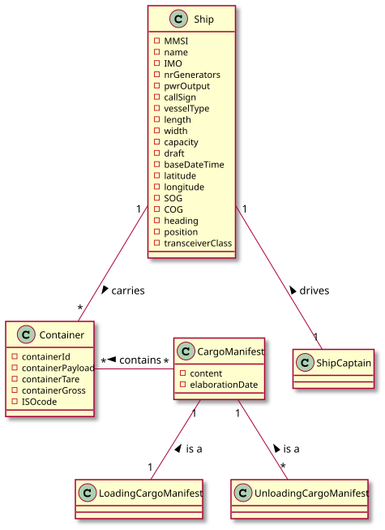
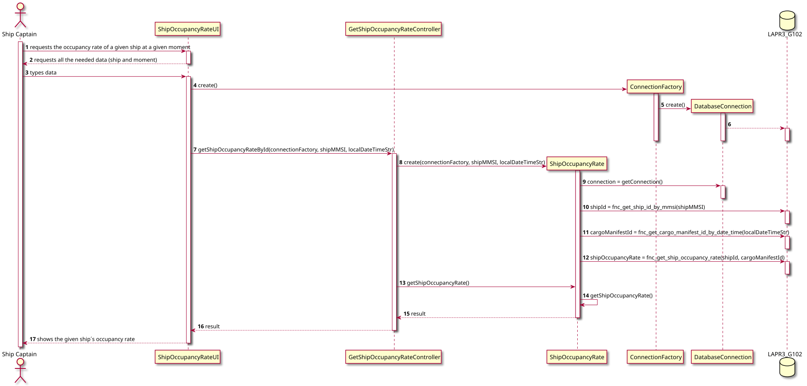
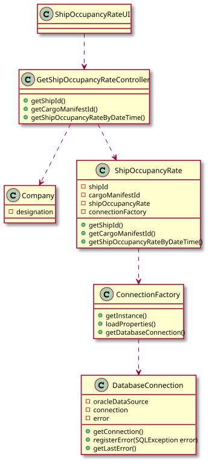

# User Story 209 - Get Ship Occupancy Rate

### User Story Description

As a **Ship Captain**, I want to know the occupancy rate of a given ship at a given
moment.

### Acceptance Criteria

* 	**AC1:** Ship is properly identified.
*	**AC2:** Reuses US208.
*	**AC3:** Occupancy rate is properly computed.

### System Sequence Diagram (SSD)

### Relevant Domain Model Excerpt

### Sequence Diagram (SD)

### Class Diagram (CD)

