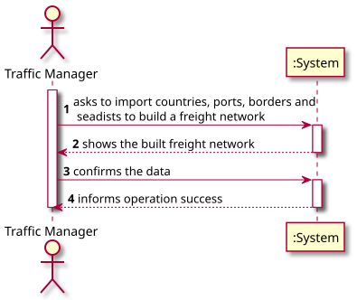
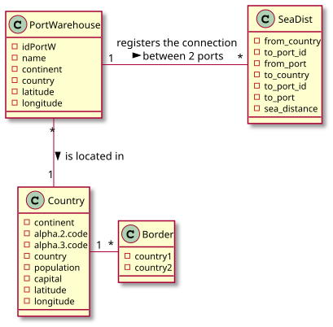
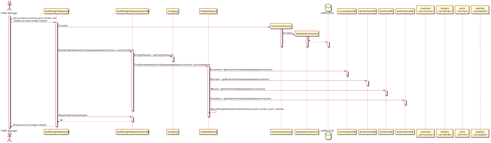
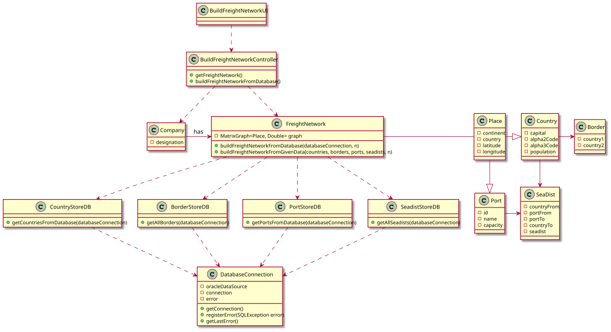

# User Story 301 - Build Freight Network

### User Story Description

As a **Traffic manager**, I which to import data from countries, ports, borders and
seadists from the database to build a freight network.

### Acceptance Criteria

* 	**AC1:** The capital of a country has a direct connection with the capitals of the
     countries with which it borders. The ports of a country, besides connecting with all the ports of the same country, the port closest to the
     capital of the country connects with it; and finally, each port of a country
     connects with the n closest ports of any other country.
*	**AC2:** The calculation of distances in Kms between capitals, and ports and
     capitals must be done using the GPS coordinates.
*	**AC3:** The graph must be implemented using the adjacency matrix
     representation and ensuring the indistinct manipulation of capitals and
     seaports.

### System Sequence Diagram (SSD)

### Relevant Domain Model Excerpt

### Sequence Diagram (SD)

### Class Diagram (CD)

