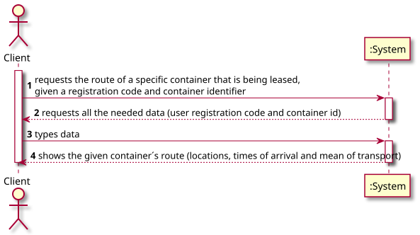
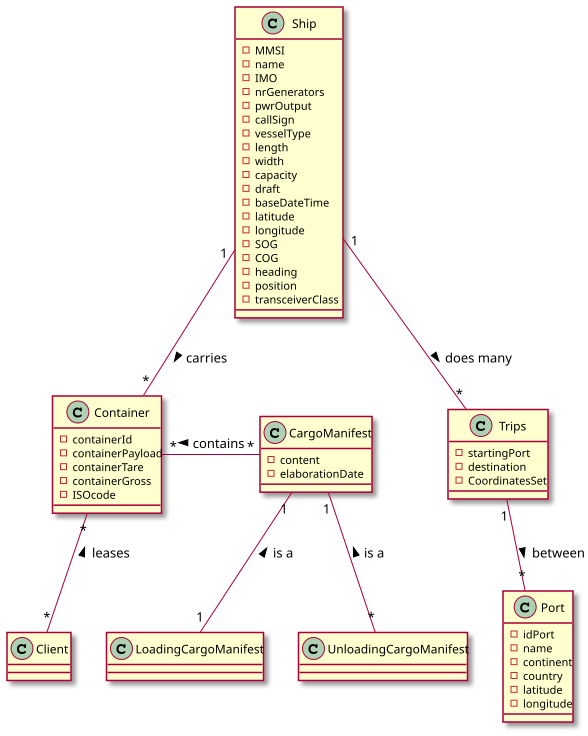
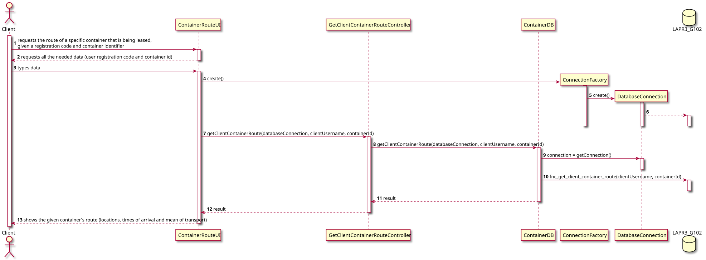
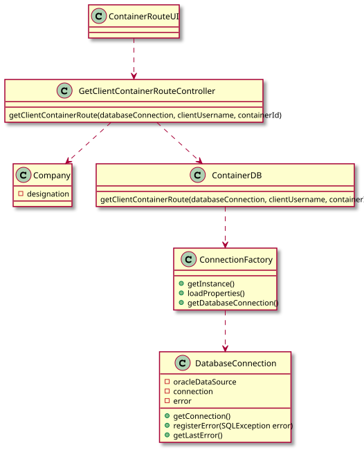

# User Story 305 - Get Client Container Route

### User Story Description

As a **Client**, I want to know the route of a specific container I am leasing.

### Acceptance Criteria

* 	**AC1:** Users provide their registration code, the container identifier and get its
     path, from source to current location indicating time of arrival and
     departure at each location and mean of transport (ship or truck) between
     each pair of locations.
*	**AC2:** When the provided identifier is not valid or, being valid, is not leased by
     the client, a warning is returned.

### System Sequence Diagram (SSD)

### Relevant Domain Model Excerpt

### Sequence Diagram (SD)

### Class Diagram (CD)

