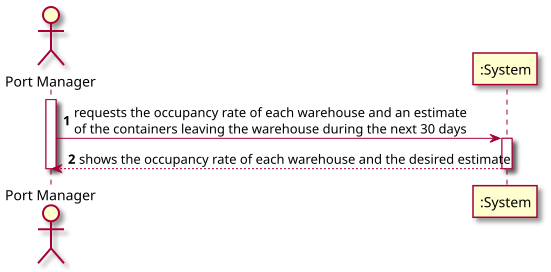
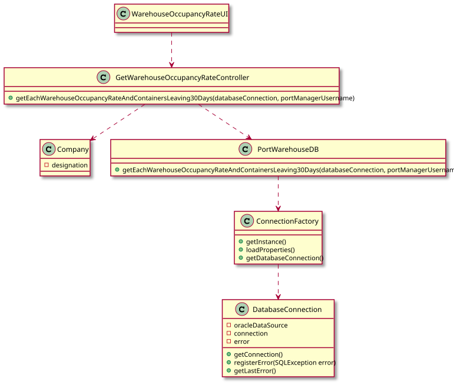

# User Story 306 - Get Each Warehouse Occupancy Rate And An Estimate Of Containers Leaving During 30 Days

### User Story Description

As a **Port manager**, I want to know the occupancy rate of each warehouse and an
estimate of the containers leaving the warehouse during the next 30 days.

### Acceptance Criteria

* 	**AC1:** For each warehouse the required output is available.
*	**AC2:** The 30 days period is properly considered.

### System Sequence Diagram (SSD)

### Relevant Domain Model Excerpt

### Sequence Diagram (SD)

### Class Diagram (CD)

