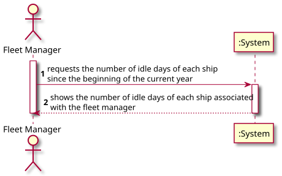
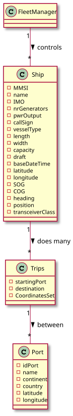
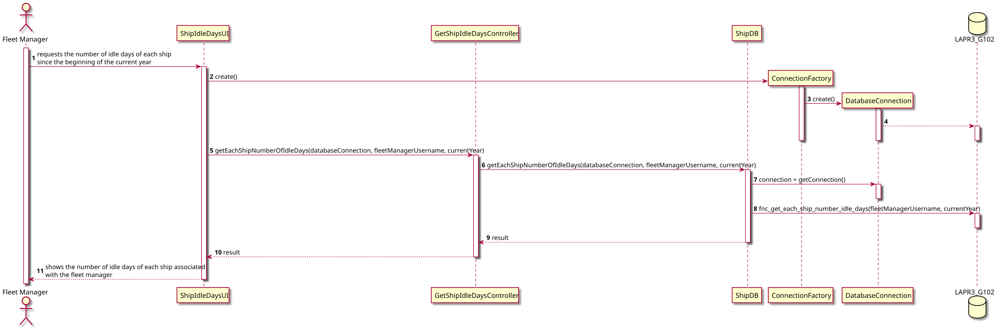
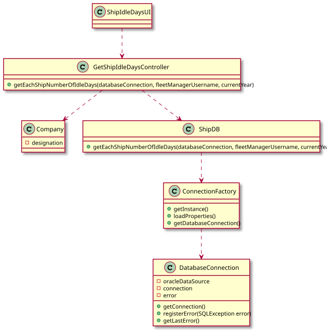

# User Story 404 - Get the number of idle days of each ship

### User Story Description

As a **Fleet Manager**, I want to know the number of days each ship has been idle
since the beginning of the current year.

### Acceptance Criteria

* 	**AC1:** Current year is properly identified.
*	**AC2:** Idle time is correctly computed per ship.
*   **AC3:** Ships with no idle time are also reported.

### System Sequence Diagram (SSD)

### Relevant Domain Model Excerpt

### Sequence Diagram (SD)

### Class Diagram (CD)

