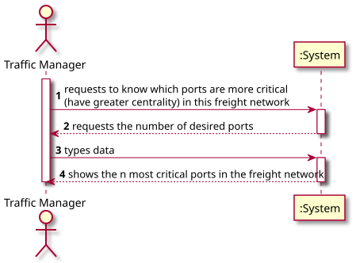
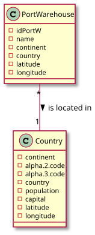
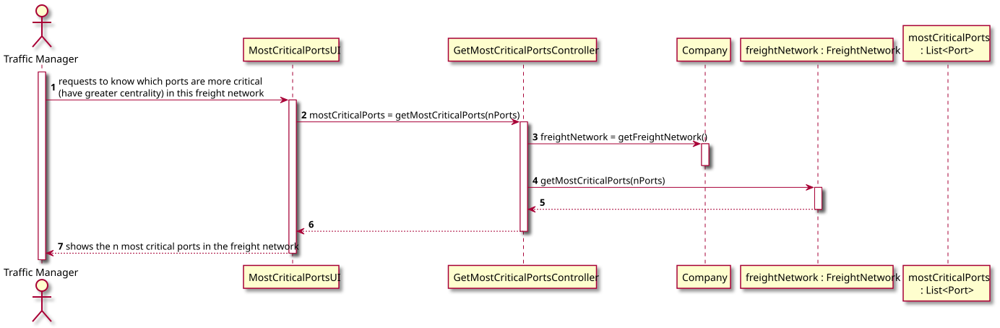
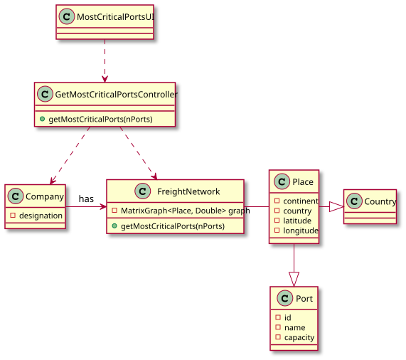

# User Story 404 - Get Most Critical Ports

### User Story Description

As a **Traffic manager**, I wish to know which ports are more critical (have greater
centrality) in this freight network.

### Acceptance Criteria

* 	**AC1:** Return the n ports with greater centrality.
*	**AC2:** The centrality of a port is defined by the number of shortest paths that
     pass through it.

### System Sequence Diagram (SSD)

### Relevant Domain Model Excerpt

### Sequence Diagram (SD)

### Class Diagram (CD)

