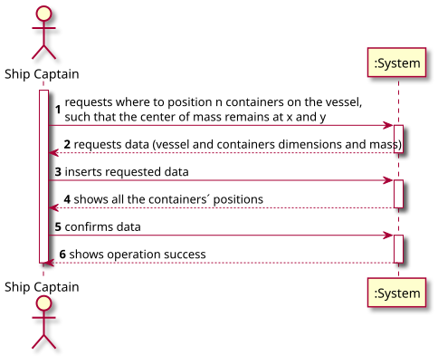
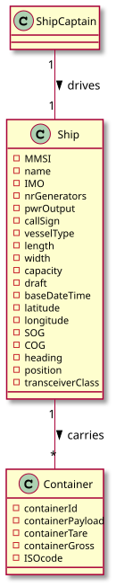
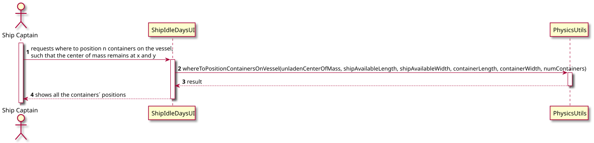
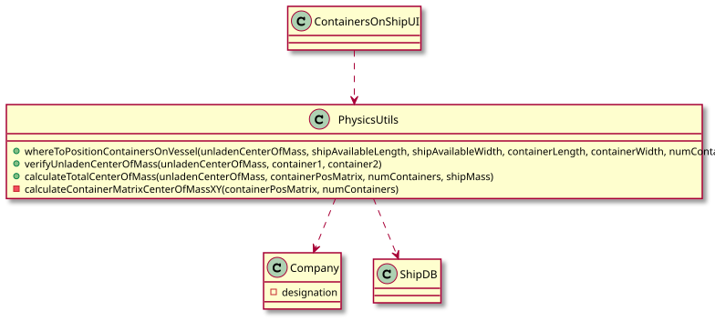

# User Story 419 - Know where to position containers on the vessel

### User Story Description

As a **Ship Captain**, I want to know where to position, for example, one hundred
(100) containers on the vessel, such that the center of mass remains at xx and yy,
determined in the previous point.

### Acceptance Criteria

* 	**AC1:** Identify the area/volume of a container and its center of mass. The
     distribution of the mass inside the container will be considered uniform.
*	**AC2:** Make a sketch of the distribution and loading on the vessel.
*   **AC3:** Calculate the center of mass of the sketch performed.

### System Sequence Diagram (SSD)

### Relevant Domain Model Excerpt

### Sequence Diagram (SD)

### Class Diagram (CD)

